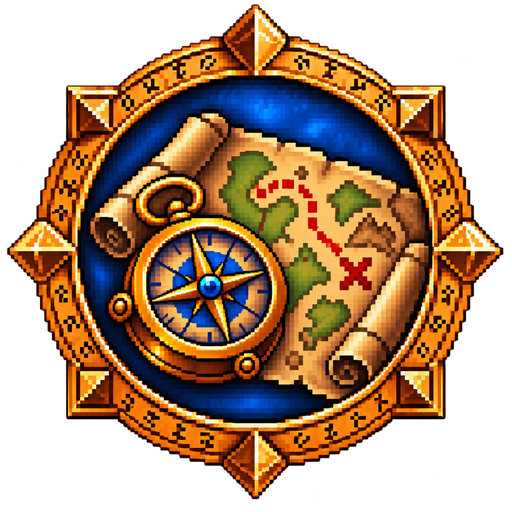

# Glimpse: Travel

<p align="center"></p>

<p align="center">
  <a href="https://github.com/N3zr0k/Glimpse_Travel/releases"></a>
  <a href="https://github.com/N3zr0k/Glimpse_Travel/releases"></a>
  <a href="https://github.com/N3zr0k/Glimpse_Travel/commits/main"></a>
  <a href="https://github.com/N3zr0k/Glimpse_Travel/actions/workflows/ci.yml"></a>
</p>

Comfort for travelling: one double click mounts you up, dismounts, or uses your class ability for faster travel when no
mount is possible. The flight map shows how long a flight takes, and a countdown runs to the arrival on the Deeprun Tram
and on flight routes.

Requires [Glimpse](https://github.com/N3zr0k/Glimpse) 0.3.21 or newer. For WoW Forever (interface 16001).

## Contents

* [Features](#features)
* [Options](#options)
* [Commands](#commands)
* [Installation](#installation)
* [For developers](#for-developers)
* [Credits](#credits)
* [License](#license)

## Features

### Travel with a double click

Hold the chosen key (Alt by default) and double-click the game world with the chosen mouse button (right by default):

| Situation | What happens |
| --- | --- |
| Mounted | Dismount |
| In Travel Form, Aquatic Form or Ghost Wolf | Leave the form |
| In water | Aquatic Form (druid); otherwise a Swim Speed Potion from your bags, if switched on |
| On land, mount allowed and learned | A mount from your collection: a favorite if you have one, otherwise any usable mount |
| On land, no mount allowed or riding not learned yet | Class ability: Travel Form (druid, outdoors), Ghost Wolf (shaman), Aspect of the Cheetah (hunter) |
| None of the above possible (also in water) | Speed ability: Sprint (rogue), Dash (druid in Cat Form); otherwise a Swiftness Potion, if switched on |

* Works only out of combat (the game blocks it for all addons in combat).
* The class abilities are never used in water.
* Abilities and potions are skipped while their cooldown runs.
* A potion is not drunk again while its buff is active; Aspect of the Cheetah is not cast again while it is active.
* The key can also be set once for all Glimpse addons (Glimpse options, General, Double click).

### Flight time on the flight map

Hover a flight point on the flight map:

```
Ironforge
Flight time: 2:35
Average of 3 flights
```

* The times are measured by Glimpse (Travel module of the core) from take-off to landing, on all your characters.
* A route you never flew in one go is estimated from its legs, if every leg is measured: `Flight time: about 4:10`.
* Without any measurement: `Flight time: not measured yet`.

### Arrival countdown

On the Deeprun Tram and on flight routes a green line at the top of the screen counts down to the arrival:
`Arrival in Stormwind in 58 s`. The tram always takes 58 seconds (sent by Glimpse at departure); a flight uses the average
Glimpse measured for this route, until then it says `Next stop: ... (flight time is being measured)`. Optional: a sound 5 seconds before the arrival.
During the tram ride a note appears in white 1 second after departure, at 25, 42 and 75 % of the travel time
and on arrival (texts in `Modules/Arrival/ArrivalPoints.lua`). Moving during the
ride shows a random safety notice in red, at most every 20 seconds (`Modules/Arrival/ArrivalWarnings.lua`). An extra line
shows the speed of the tram in km/h or mph (distance unit in the Glimpse options) (`Modules/Arrival/ArrivalSpeed.lua`). Departure, arrival and the travel times come from the Travel module of Glimpse.

## Options

Open them with `/gli config`, then Glimpse > Travel, tab "General":

* **Mount up automatically:** the double click summons a mount and dismounts.
* **Use a class ability to travel faster:** Travel Form, Ghost Wolf, Aspect of the Cheetah; in water Aquatic Form.
* **Use a speed ability (Sprint, Dash):** on by default.
* **Drink a speed potion:** Swiftness Potion, off by default, because it uses up a potion.
* **Drink a swim speed potion in water:** off by default, because it uses up a potion.
* **Show the flight time in the tooltip:** on the flight map (on by default).
* **Show a countdown to the arrival** (on), **Play a sound shortly before the arrival** (off), **Show notes during the
  Deeprun Tram ride** (on), **Show a warning when you move during the Deeprun Tram ride** (on),
  **Show the speed of the Deeprun Tram** (on), **Show the speed on gryphon flights** (on), **Show your speed at the player portrait** (on).
* **Modifier key and mouse button** of the double click. Hidden while all of these switches are off; the double click then
  also disappears from the list in the Glimpse options.

Settings are stored in the namespace `Glimpse_Travel` of the Glimpse settings (`GlimpseSettings`).

## Commands

| Command | Does |
| --- | --- |
| `/gli travel` | Settings, key, what the client reports about mounts and travel abilities, the current ride with seconds since departure, and the last double clicks |

## Installation

Install [Glimpse](https://github.com/N3zr0k/Glimpse/releases) first, then unpack this addon next to it into the AddOns
folder of the Forever client, during the beta for example `D:\Games\World of Warcraft\_classic_beta_\Interface\AddOns`.
The folder must be called `Glimpse_Travel`.

## For developers

The double click runs through the double-click dispatcher of Glimpse (`Glimpse:RegisterDoubleClick`, see `DEVELOPER.md`
in the Glimpse repository). `Modules/TravelAction/TravelAction.lua` decides what a click does; the class abilities are a
table per class in `TravelActionClass.lua`, the swim potions in `TravelActionWater.lua`. Distance, zones and flight times
are recorded by the Travel module of Glimpse; this addon only reads them (`GlimpseDB:Get("travel")`, kinds `flight` and
`flighttime`, see `Modules/FlightTime/FlightTime.lua`).

`docs/FEATURES.md` lists all features and what the addon reads from the database, `docs/CURSEFORGE.md` holds the texts
for the CurseForge project page, `docs/Files.md` describes every file.

The addon lives in the folder `Glimpse_Travel/` of the repository; link that folder into the AddOns folder (junction) and
`/reload` after each change. Checks:

```
lua tests/run.lua
luacheck .
python3 tools/check.py
```

## Credits

Author: N3zr0k.

## License

MIT, see [LICENSE](LICENSE).
